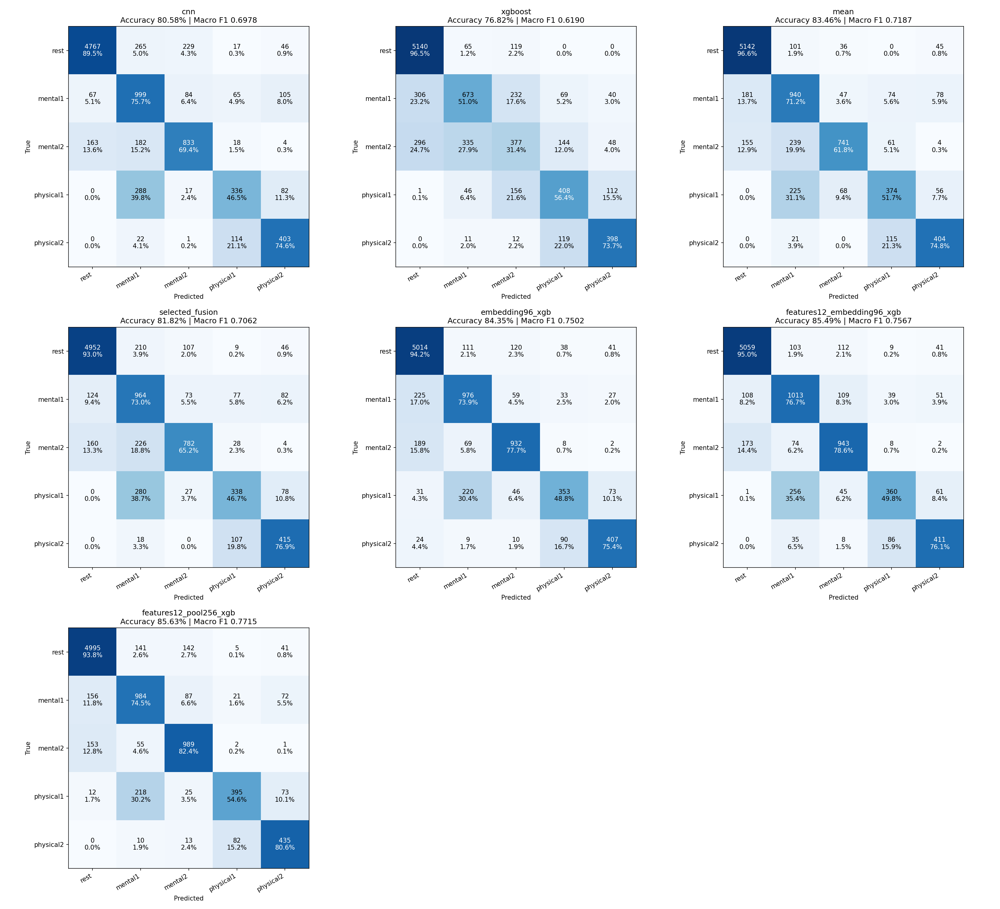
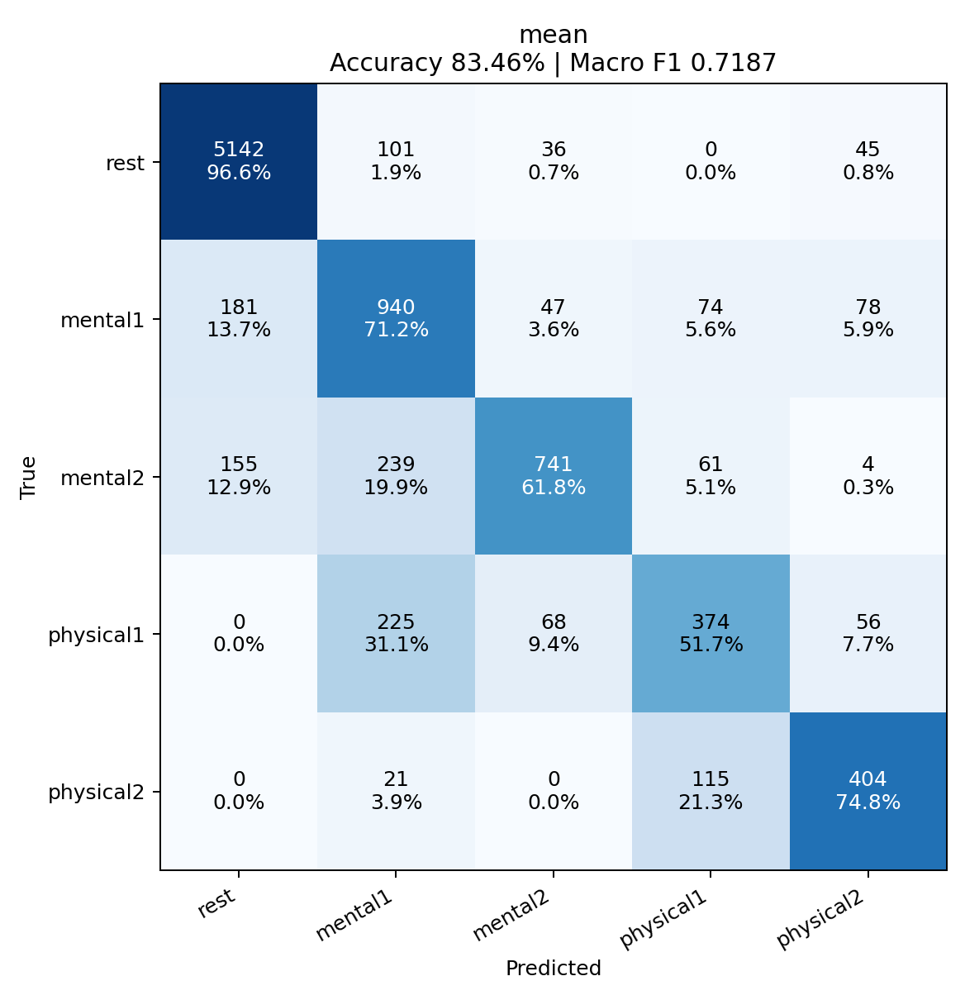
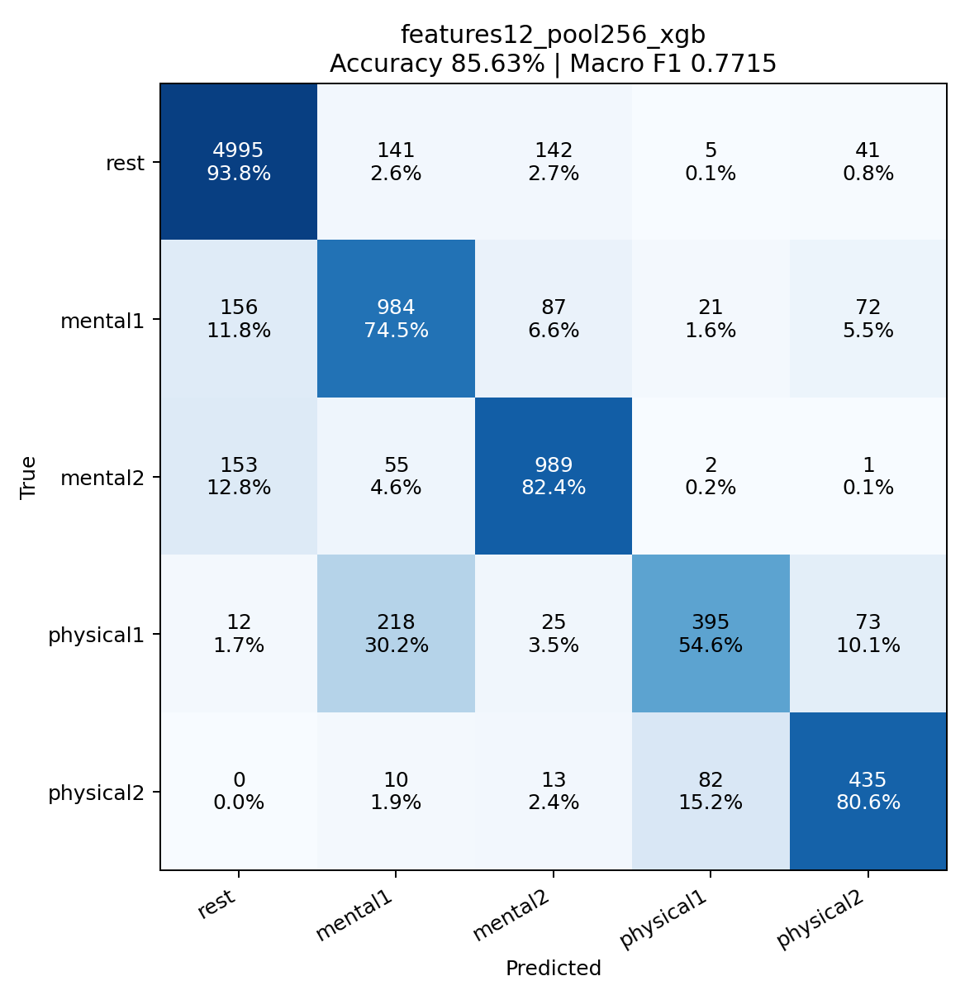

# data_new 전체 평가 결과

44개 녹화, 9,107개 윈도우. **43개 학습 / 1개 테스트, 44-fold LORO**.

[분류 점검 보고서](DATA_AUDIT.md)

## 전체 결과

| 방식 | 정확도 | Macro F1 |
|---|---:|---:|
| cnn | 80.58% | 0.6978 |
| xgboost | 76.82% | 0.6190 |
| mean | 83.46% | 0.7187 |
| selected_fusion | 81.82% | 0.7062 |
| embedding96_xgb | 84.35% | 0.7502 |
| features12_embedding96_xgb | 85.49% | 0.7567 |
| features12_pool256_xgb | 85.63% | 0.7715 |

이번 비교에서 Macro F1 기준 가장 높은 방식은 **features12_pool256_xgb**입니다. 동일 데이터에서 후보를 비교한 탐색 결과로, 독립 데이터에서 우수성을 확인한 것은 아닙니다.

## 라벨과 구간

앞 300초는 rest, 이후는 phase separation 표에 대응하는 폴더 클래스입니다. math는 300초 자극, plank는 실제 파일명의 지속 시간을 사용합니다. recovery는 제외합니다. 경계 제외·40초 CNN·2초 간격·기존 특징별 윈도우를 유지했습니다.

## 학습 및 선택

각 outer fold의 테스트 녹화는 모든 학습·선택에서 제외합니다. 나머지 43개 중 클래스별 1개씩 4개를 내부 검증으로 사용하고 39개로 CNN과 XGBoost를 학습하여 CNN epoch와 확률 결합 가중치를 정합니다. 이후 CNN과 XGBoost를 **43개 전체로 처음부터 다시 학습**해 테스트합니다. CNN 중간 특징 XGBoost도 해당 최종 CNN과 같은 43개 학습 녹화만 사용합니다. 과거 데이터의 epoch·모델·가중치는 재사용하지 않았습니다.

## 방식 설명

- cnn: 3채널 원시 신호 CNN
- xgboost: Plan C 12개 특징
- mean: CNN/XGBoost 확률 50:50 평균
- selected_fusion: 내부 검증에서 산술/기하 평균과 비중 선택
- embedding96_xgb: CNN 96차원 은닉층 → XGBoost
- features12_embedding96_xgb: 12개 생체 특징 + 96차원 은닉층 → XGBoost
- features12_pool256_xgb: 12개 생체 특징 + 256차원 pooling → XGBoost

## 클래스별 재현율

| 클래스 | cnn | xgboost | mean | selected_fusion | embedding96_xgb | features12_embedding96_xgb | features12_pool256_xgb |
|---|---:|---:|---:|---:|---:|---:|---:|
| rest | 89.5% | 96.5% | 96.6% | 93.0% | 94.2% | 95.0% | 93.8% |
| mental1 | 75.7% | 51.0% | 71.2% | 73.0% | 73.9% | 76.7% | 74.5% |
| mental2 | 69.4% | 31.4% | 61.8% | 65.2% | 77.7% | 78.6% | 82.4% |
| physical1 | 46.5% | 56.4% | 51.7% | 46.7% | 48.8% | 49.8% | 54.6% |
| physical2 | 74.6% | 73.7% | 74.8% | 76.9% | 75.4% | 76.1% | 80.6% |

## Confusion matrices



행은 실제 분류, 열은 예측 분류입니다. 셀은 개수와 행별 비율입니다.

### cnn


### mean



### features12_pool256_xgb



## 재현 및 변경 사항

새 `scripts/evaluation/audit_phase_folders.py`가 Excel과 폴더·해시를 검사합니다. 새 `scripts/evaluation/run_dataset_suite.py`가 데이터 수에 맞춘 전체 평가를 실행합니다. 기존 모델·특징·전처리 코드는 그대로 사용합니다.

```powershell
./.venv/Scripts/python.exe -u -m scripts.evaluation.run_dataset_suite --data-dir data_new --output-dir output_data_new --aliases output_data_new/label_aliases.json
```

fold별 모델/검증 기록/확률은 `folds/`, 전체 예측은 `predictions.csv`, 설정과 입력·코드 해시는 `run_config.json`, 전체 지표는 `results.json`입니다. 동일 설정의 완료 단계는 재사용합니다.

## 해석 범위

기존 30개 평가와 데이터 구성 및 일부 라벨이 달라 점수 차이를 모델 개선만으로 해석할 수 없습니다. 녹화 단위 평가이며 동일 참가자의 다른 녹화가 학습에 들어갈 수 있습니다. 전체 녹화 정규화와 초기 rest 보정을 사용하는 오프라인 평가입니다.
