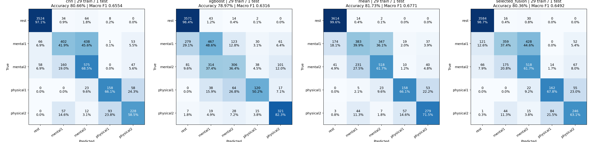
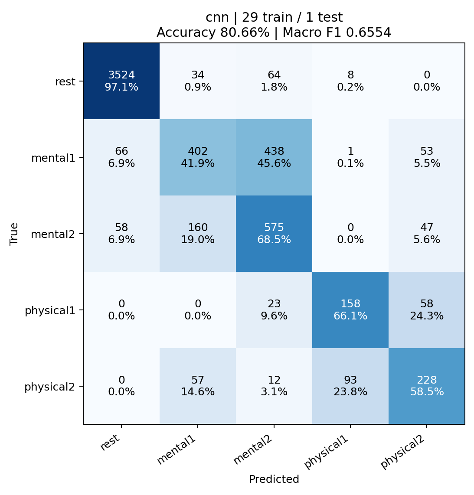
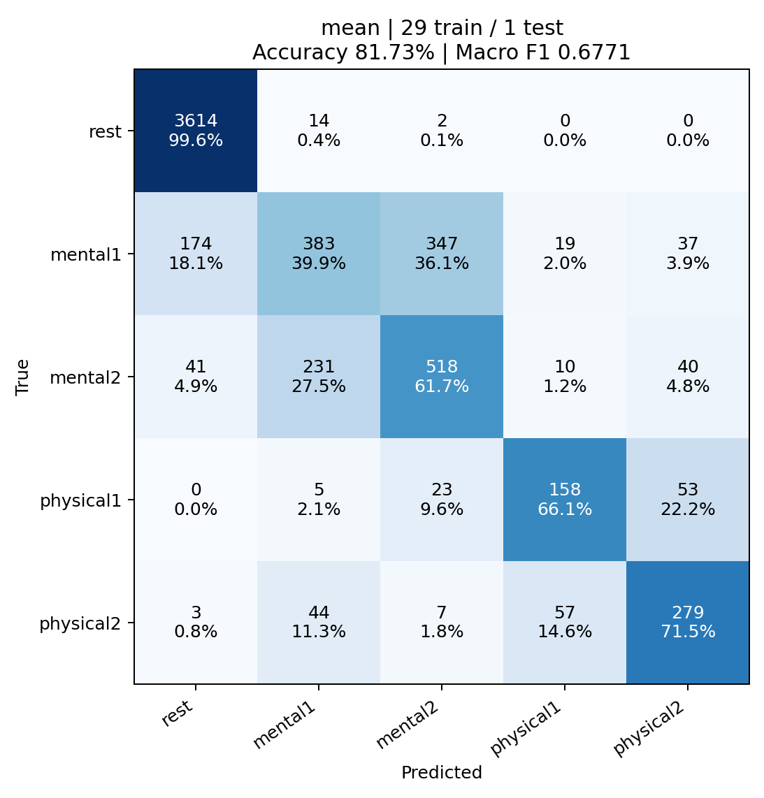

# 29개 학습 / 1개 테스트: 30-fold 결과

총 6,059개 윈도우, rest 포함 5개 클래스. 각 녹화를 한 번씩 테스트했습니다.

| 모델 | 정확도 | Macro F1 |
|---|---:|---:|
| cnn | 80.66% | 0.6554 |
| xgboost | 78.97% | 0.6316 |
| mean | 81.73% | 0.6771 |
| selected_fusion | 80.36% | 0.6492 |

단순 평균 결합은 CNN 단독 대비 정확도 +1.07%p, Macro F1 +0.0217입니다. 이번 비교에서는 단순 평균이 두 지표에서 가장 높았습니다. 테스트 결과로 고른 후보의 우수성은 새로운 독립 데이터에서 추가 확인해야 합니다.

단순 평균은 `0.5 × CNN 확률 + 0.5 × XGBoost 확률`입니다. selected_fusion은 내부 검증으로 고른 산술/기하 평균과 가중치를 사용하는 별도 방식입니다.

## 이전 25개 학습과 비교

| 모델 | 이전 정확도 / Macro F1 | 현재 정확도 / Macro F1 |
|---|---|---|
| cnn | 79.22% / 0.6545 | 80.66% / 0.6554 |
| xgboost | 75.28% / 0.5404 | 78.97% / 0.6316 |
| mean | 80.01% / 0.6506 | 81.73% / 0.6771 |
| selected_fusion | 78.79% / 0.6486 | 80.36% / 0.6492 |

## 클래스별 재현율

| 클래스 | CNN | XGBoost | 단순 평균 | 검증 선택 결합 |
|---|---:|---:|---:|---:|
| rest | 97.1% | 98.4% | 99.6% | 98.7% |
| mental1 | 41.9% | 48.6% | 39.9% | 37.4% |
| mental2 | 68.5% | 36.4% | 61.7% | 61.7% |
| physical1 | 66.1% | 50.2% | 66.1% | 67.8% |
| physical2 | 58.5% | 82.3% | 71.5% | 63.1% |


## 학습 방식

각 fold의 기존 내부 검증에서 정한 epoch와 결합 가중치를 재사용했습니다. 이후 CNN과 XGBoost 모두 나머지 29개 녹화 전체로 처음부터 재학습했습니다. 내부 검증용 4개도 최종 학습에 포함됩니다. 테스트 녹화는 설정 선택과 학습에서 제외했습니다. CNN 학습률 스케줄은 내부 검증과 같은 24-epoch 주기를 유지합니다.

## Confusion matrices



행은 실제 클래스, 열은 예측 클래스이며 각 셀은 개수와 행별 비율입니다.

### CNN



### CNN + XGBoost 단순 평균



## 파일

- `folds/`: fold별 CNN, XGBoost 모델, 학습 파일 목록, 테스트 확률
- `results.json`: 전체·클래스별 지표 및 fold 설정
- `predictions.csv`: 모든 out-of-fold 예측과 확률
- `inner_selection/`: 재사용한 내부 검증 기록
- `run_config.json`: 입력 해시와 실행 설정

## 재실행

```powershell
./.venv/Scripts/python.exe -u -m scripts.evaluation.run_loro_refit
```
완료된 fold는 동일 설정일 때만 재사용합니다.

원본 데이터는 기존 `data/Mental1`, `Mental2`, `Physical1`, `Physical2` 구조로 준비합니다. 원시 신호 캐시가 없으면 자동 생성합니다. 실제 패키지 버전은 `runtime-packages.txt`에 기록했습니다. 입력 해시 또는 환경이 다르면 기존 체크포인트를 재사용하지 않습니다. 모델의 입력 순서는 `results.json`의 `features`, XGBoost 출력 순서는 `saved_xgboost_class_order`, CNN 출력 순서는 `classes`를 확인합니다.

## 해석 범위

동일 참가자의 다른 녹화가 학습에 포함될 수 있습니다. 전체 녹화 정규화와 초기 rest 보정을 사용하는 오프라인 평가이며, 새로운 독립 데이터에서 확인한 결과는 아닙니다. 결합이 모든 클래스에서 개선된다고 보장하지 않습니다.
