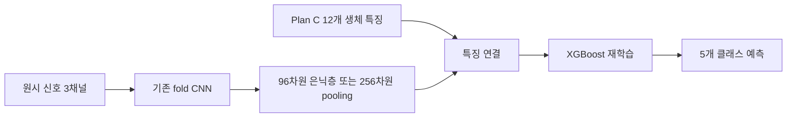
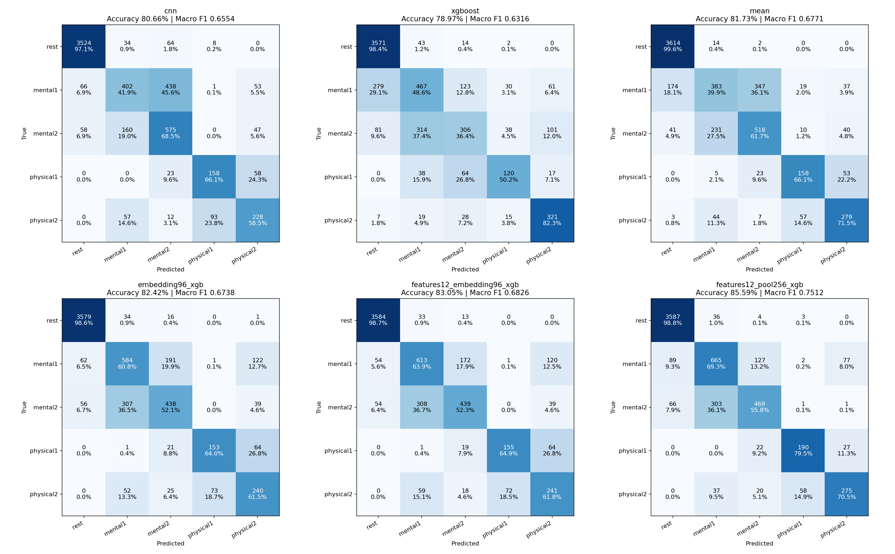
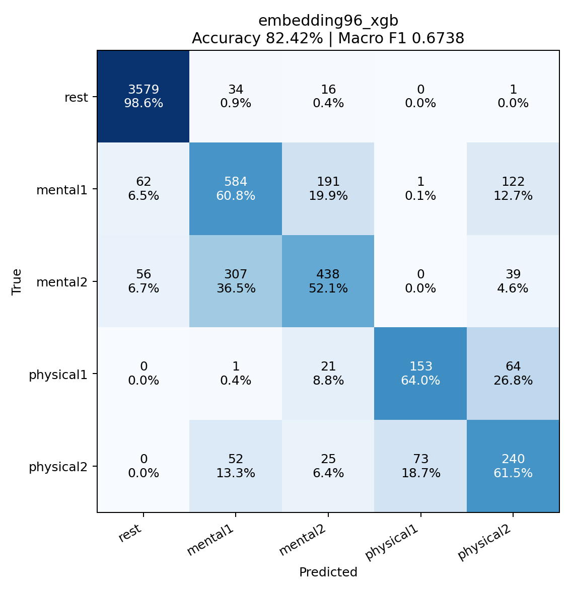
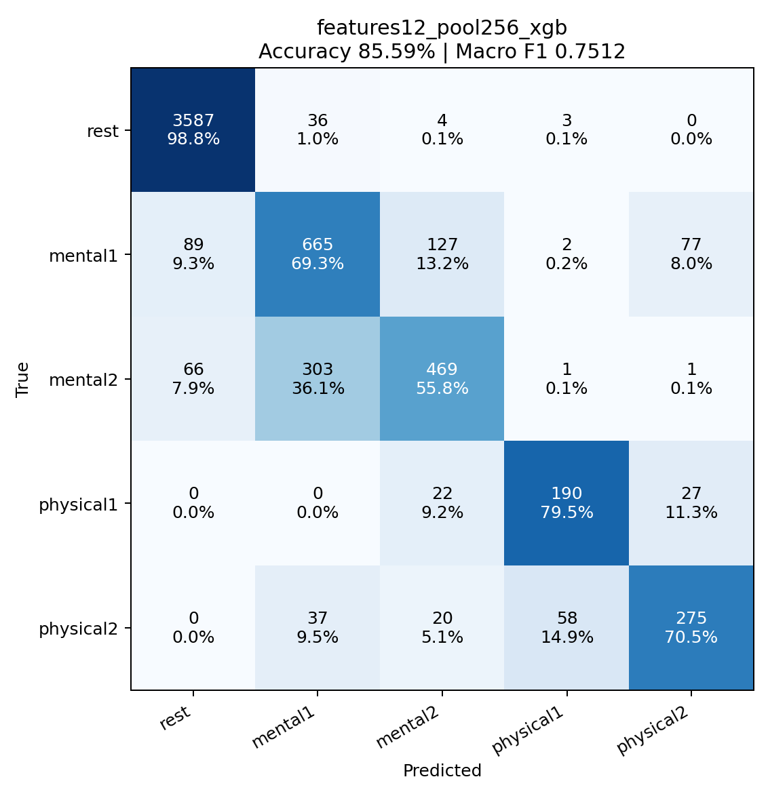

# CNN 중간 특징 + XGBoost 결과 및 변경 보고서

## 결과

| 모델 | 정확도 | Macro F1 |
|---|---:|---:|
| cnn | 80.66% | 0.6554 |
| xgboost | 78.97% | 0.6316 |
| mean | 81.73% | 0.6771 |
| embedding96_xgb | 82.42% | 0.6738 |
| features12_embedding96_xgb | 83.05% | 0.6826 |
| features12_pool256_xgb | 85.59% | 0.7512 |

이번 비교에서 Macro F1이 가장 높은 방식은 **features12_pool256_xgb**입니다. 동일 데이터에서 여러 방식을 비교한 탐색 결과이며, 새로운 독립 데이터에서 우수성을 확인한 것은 아닙니다.

## 무엇을 바꿨나

기존 출력 확률 평균 대신 CNN 내부 숫자 표현을 XGBoost의 입력 특징으로 사용했습니다.

| 새 방식 | 입력 | 특징 개수 |
|---|---|---:|
| embedding96_xgb | CNN 마지막 은닉층 ReLU 출력 | 96 |
| features12_embedding96_xgb | Plan C 생체 특징 + 마지막 은닉층 | 108 |
| features12_pool256_xgb | Plan C 생체 특징 + convolution의 평균/최댓값 pooling | 268 |



## 평가와 학습

- 30개 녹화, 6,059개 윈도우, rest 포함 5개 클래스입니다.
- 각 fold는 `output_new_1`에서 29개 녹화로 학습한 CNN을 고정하여 사용합니다. CNN 재학습은 하지 않았습니다.
- 해당 CNN 한 개로 그 fold의 학습과 테스트 특징을 모두 추출합니다. 서로 다른 fold CNN의 임베딩을 섞지 않습니다.
- XGBoost는 해당 29개 녹화의 특징과 라벨로 새로 학습합니다. 테스트 녹화는 CNN과 XGBoost 모두 학습에서 제외됐습니다.
- dropout과 BatchNorm은 평가 모드로 고정합니다. 테스트 추론 중 모델 파라미터를 업데이트하지 않습니다.
- XGBoost는 기존 Plan C의 400 trees, depth 4, learning rate 0.05 및 class weighting을 유지했습니다.
- 특징 종류 세 가지는 실행 전에 고정했으며 테스트 점수로 하이퍼파라미터를 재선택하지 않았습니다.
- 기존 CNN, Plan C XGBoost, 단순 평균 결과는 같은 윈도우의 저장된 out-of-fold 확률을 사용한 기준값입니다.

## 변경 파일

- 새 코드: `scripts/evaluation/run_cnn_embeddings.py` — 중간 특징 추출, fold별 XGBoost 학습, 재시작, 지표·그림·보고서 생성
- 새 결과 폴더: `output_new_2/`
- 기존 CNN 구조, Plan C 설정, 과거 결과 파일은 수정하지 않았습니다.

## Confusion matrices



행은 실제 클래스, 열은 예측 클래스입니다. 각 셀에 개수와 실제 클래스 내 비율을 표시합니다.

### embedding96_xgb



### features12_embedding96_xgb


### features12_pool256_xgb



## 재실행

```powershell
./.venv/Scripts/python.exe -u -m scripts.evaluation.run_cnn_embeddings
```

`output_new_1`의 모델과 특징 CSV 및 `output_new/cnn_phase2/raw_windows_250hz.npz`가 필요합니다. 동일 입력·코드·환경의 완료 fold는 재사용합니다.

## 출력 파일

- `results.json`: 전체·클래스별 성능, 분할 정보
- `predictions.csv`: 녹화·시간별 모든 방식의 예측과 확률
- `folds/`: 새 XGBoost 모델, 입력 특징 순서, CNN 원본 체크포인트 경로, 입력 특징 중요도, 테스트 확률
- `run_config.json`: 입력·코드·CNN 체크포인트 해시, 환경과 설정

## 해석상 한계

CNN은 같은 29개 학습 녹화의 라벨을 사용해 만든 표현이므로 학습 특징을 지나치게 잘 구분할 수 있습니다. 테스트 녹화는 독립적으로 유지했지만 이 방식은 out-of-fold 확률로 학습하는 stacking과 다릅니다. 녹화 단위 평가이고 참가자 단위 독립 평가는 아닙니다. 기존 전체 녹화 정규화와 초기 rest 보정을 유지합니다.
