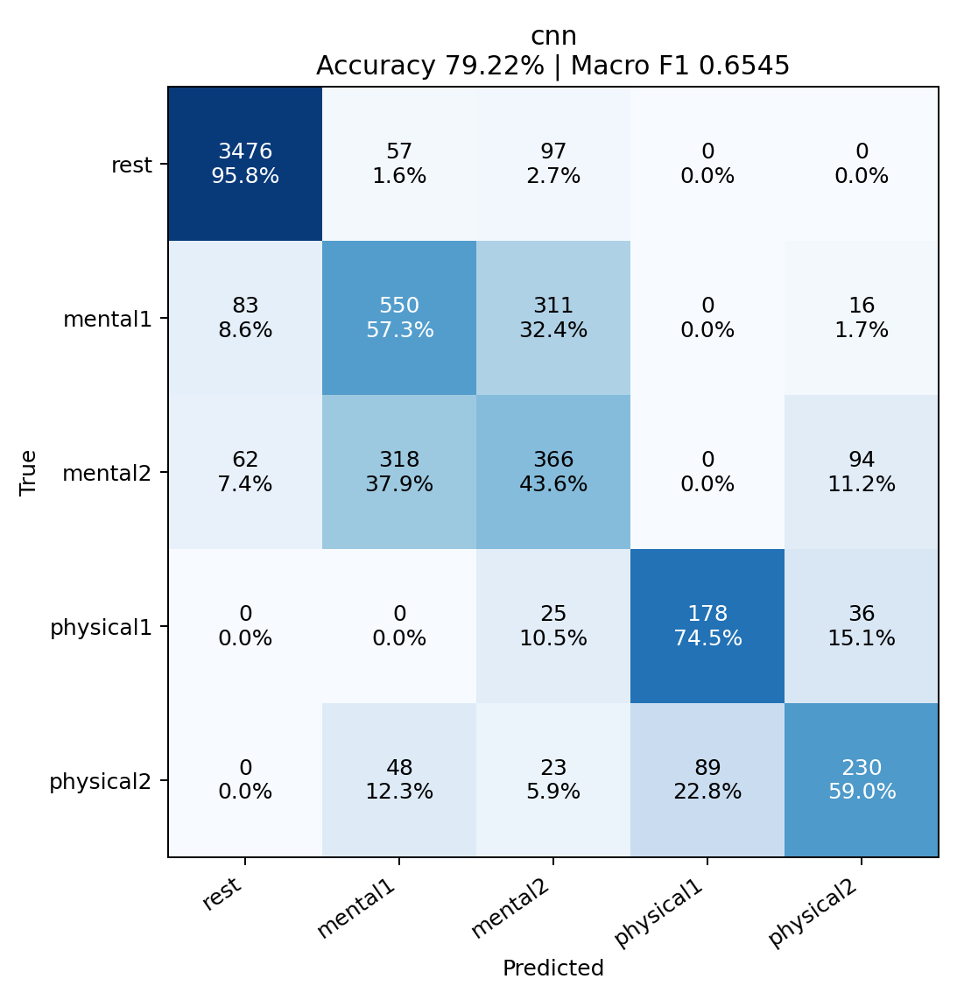
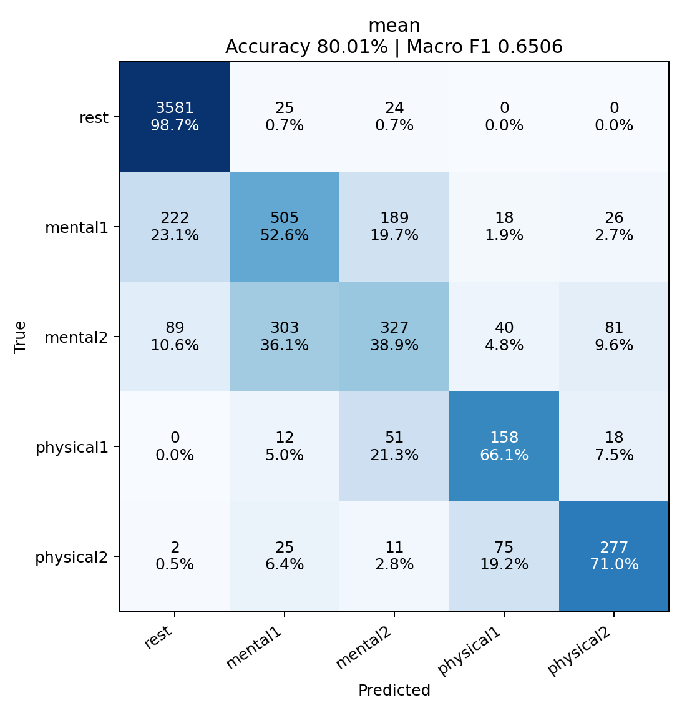
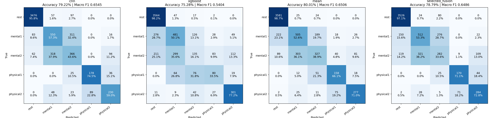

# CNN / XGBoost 30-fold comparison

**Updated run:** [29-training-recording results](../output_new_1/README.md) supersede this historical 25-training-recording comparison. Both models were refit on all 29 non-test recordings; equal averaging achieved 81.73% accuracy and 0.6771 macro F1.

## Completed results (2026-09-15)

All 30 folds completed on the RTX 3060 Ti. All four methods were evaluated on the same 6,059 windows, with every window tested exactly once.

| Method | Accuracy | Macro F1 |
|---|---:|---:|
| CNN | 79.22% | **0.6545** |
| XGBoost | 75.28% | 0.5404 |
| Equal probability mean | **80.01%** | 0.6506 |
| Inner-validation-selected arithmetic/geometric fusion | 78.79% | 0.6486 |

Equal averaging gained 48 correct windows (+0.79 percentage points in accuracy), but did not improve macro F1. Rest recall increased from 95.8% to 98.7%, and physical2 recall from 59.0% to 71.0%. Mental1, mental2, and physical1 recall decreased. CNN remains the strongest of these evaluated procedures by the preselected macro F1 criterion; there is no evidence here that fusion improves overall class-balanced performance. Equal averaging has the highest observed accuracy, but selecting it after this comparison is exploratory and needs independent confirmation.

The validation-selected procedure used CNN weights 0.25 in 2 folds, 0.5 in 9, 0.75 in 7, 0.9 in 7, and 1.0 in 5. It is not a single globally optimized weight. No outer test labels were used for fold-level weight selection.

### CNN



### Equal-mean CNN + XGBoost



### All procedures



Rows are true classes; columns are predicted classes. Each cell contains count and percentage within the true class. Final checks confirmed 30 complete folds, 6,059 unique recording/anchor keys, finite normalized probabilities, and exact agreement between the original CNN report and the comparison report.

## Reproduce on this Windows computer

Use the project Python executable (the system Python has CPU-only PyTorch):

```powershell
./.venv/Scripts/python.exe -u -m src.cnn evaluate
./.venv/Scripts/python.exe -u -m scripts.evaluation.run_cnn_ensemble
```

GPU setup follows the [official PyTorch installation instructions](https://pytorch.org/get-started/locally/).
The local environment uses PyTorch 2.12.0+cu130 on NVIDIA GeForce RTX 3060 Ti.

## Protocol

### Follow-up: why the historical Plan C score differs

The XGBoost row above is a **25-training-recording comparison baseline**, not the original Plan C 29-training-recording LORO result. The original Plan C holds out only the test recording. The fusion experiment additionally reserves four recordings to obtain honest validation probabilities, then retains the 25-recording model for testing. Both have 30 outer folds, but their training sets differ.

Re-running the unmodified `src.plan_c.evaluation.evaluate_loro` on exactly the cached `output_new/cnn_xgb/features.csv` produced:

| XGBoost evaluation | Training / validation / test recordings | Accuracy | Macro F1 |
|---|---|---:|---:|
| Fusion comparison baseline | 25 / 4 / 1 | 75.28% | 0.5404 |
| Original Plan C protocol, rerun in current environment | 29 / 0 / 1 | 78.97% | 0.6316 |
| Historical user-supplied figure | Original Plan C, historical environment | 79.1% | 0.634 |

The controlled rerun recovers 3.70 percentage points of accuracy and 0.0912 macro F1. Mental2 recall recovers from 16.1% to 36.4%, and physical1 from 33.5% to 50.2%. Holding out an additional physical1 validation recording removes one of just four otherwise available physical1 training recordings when physical1 is the test class.

This identifies the changed training split as the main source of the difference. Exact historical reproduction is not established: the supplied image's mental2 row totals 841, whereas the current dataset has 840 mental2 windows, and historical dependency versions / feature cache have not been verified. The small remaining difference should not be assigned to a specific cause without those artifacts.

Rerun outputs: `output_new/plan_c_29train_audit/metrics.json` and `confusion_matrix.png`.

The original 29-recording baseline should be reported separately. A future ensemble can select settings inside the outer training set and then refit its base models on all 29 outer-training recordings before predicting the untouched test recording. Such refitting has not been performed in the fusion results above. Do not obtain validation predictions from a model that trained on those validation recordings.

### Shared settings

- Classes: rest, mental1, mental2, physical1, physical2.
- Initial 300 seconds are rest; stress labels come from the four data folders.
- Stress duration follows the existing recording protocol; recovery is excluded.
- 40-second, three-channel CNN input at 250 Hz; anchors every 2 seconds.
- Each outer fold holds out one entire recording. Four other recordings, one per stress class, are validation; the remaining 25 train both base models.
- CNN uses the existing maximum 24 epochs and patience 5, selected by validation macro F1.
- XGBoost uses the existing Plan C 12 features and fixed hyperparameters.
- Fusion candidates are arithmetic and geometric probability pooling, with CNN weights 0, 0.1, 0.25, 0.5, 0.75, 0.9, 1. Each fold selects by validation macro F1. Endpoints allow a standalone model when combining is unhelpful.
- Equal-score candidates prefer arithmetic equal averaging. The selected procedure is specified before looking at outer test results.
- The selected procedure is best only among these candidates on inner validation; improvement on outer test is not guaranteed.

## Outputs

- `output_new/cnn_phase2/confusion_matrix.png`: CNN pooled out-of-fold confusion matrix.
- `output_new/cnn_phase2/loro_results.json`: CNN scores, fold splits, training histories.
- `output_new/cnn_phase2/folds/`: fold CNN weights and validation/test probabilities.
- `output_new/cnn_xgb/confusion_matrices.png`: CNN, XGBoost, equal mean, selected fusion on identical test windows.
- `output_new/cnn_xgb/results.json`: metrics, class scores, candidate validation scores, chosen weights.
- `output_new/cnn_xgb/predictions.csv`: per-window out-of-fold predictions and probabilities.
- `cnn_training.log`: current CNN training progress.

## Interpretation limits

Rows are overlapping windows, not independent people. LORO does not exclude all recordings belonging to the same participant. This is an offline recording evaluation: CNN normalization uses the entire recording, and Plan C delta features assume the initial rest baseline is available. It does not establish performance for online inference without a baseline or for unseen participants. No class-folder name, recording name, or timestamp is supplied as a model feature.
