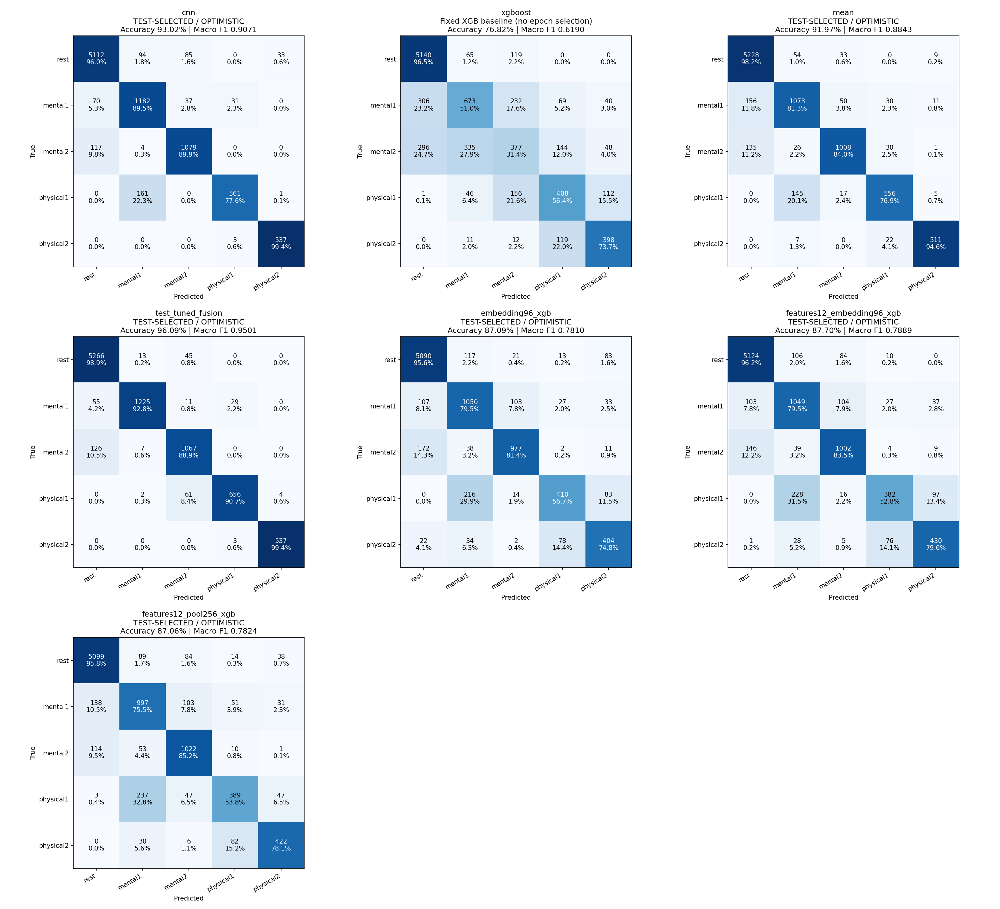

# 테스트 선택 비교 실험 결과

2026-10-27 완료. 44개 녹화의 9,107개 윈도우를 평가했습니다. 로컬 `output_data_new_test_selected_fast_50ep`에서 요약과 결과 이미지 8장을 공개했습니다.

## 핵심 요약

- 최고 결과: 테스트로 비중을 선택한 확률 결합, **96.09% / Macro F1 0.9501**.
- CNN 단독: **93.02% / Macro F1 0.9071**.
- 50:50 평균과 중간 특징 XGBoost는 CNN 단독보다 낮았습니다.
- 최고 결합은 fold마다 같은 테스트 정답으로 산술/기하 평균과 CNN 비중 0, 0.1, 0.25, 0.5, 0.75, 0.9, 1 중 선택합니다. CNN 단독도 후보에 포함되므로 테스트 정확도가 CNN보다 낮아지지 않는 구조입니다. 하나의 공통 비중을 독립 테스트로 검증한 결과는 아닙니다.

## 실험 조건과 전체 결과

**독립 테스트 성능이 아닙니다.** 43개 학습 / 1개 테스트, 44-fold. 같은 테스트 녹화로 CNN epoch를 선택하고 점수도 계산했습니다.

선택 기준: `accuracy`, 최대 50 epoch, 정확히 100%에서 종료=True, 개선 없음 patience=0(0은 비활성). 동점은 먼저 나온 epoch. 선택된 가중치를 그대로 사용하며 추가 재학습하지 않습니다.

| 방식 | 정확도 | Macro F1 |
|---|---:|---:|
| cnn | 93.02% | 0.9071 |
| xgboost | 76.82% | 0.6190 |
| mean | 91.97% | 0.8843 |
| test_tuned_fusion | 96.09% | 0.9501 |
| embedding96_xgb | 87.09% | 0.7810 |
| features12_embedding96_xgb | 87.70% | 0.7889 |
| features12_pool256_xgb | 87.06% | 0.7824 |

CNN에서 고른 epoch를 모든 CNN 기반 결합에 공통 적용했습니다. 중간 특징 XGBoost를 매 epoch 학습해서 최적 epoch를 고르는 실험은 아닙니다. `mean`은 고정 50:50 평균, `test_tuned_fusion`은 같은 테스트 정답으로 비중까지 고른 추가 편향 비교입니다. 단독 XGBoost는 고정 설정으로 학습하므로 테스트 epoch 선택의 영향을 받지 않습니다.

## Confusion matrices

행은 실제 클래스, 열은 예측 클래스입니다. 숫자는 개수와 행별 비율입니다. 전체 점수는 모든 테스트 예측을 합산하며 fold 점수의 단순 평균이 아닙니다.

## 기록

아래 checkpoint와 상세 기록은 로컬 결과 폴더에 보관하며, 이 공개 폴더에는 이미지와 요약만 포함합니다.

`folds/XX/cnn_selection.json`에 epoch별 train loss/test 정확도/test Macro F1과 선택 epoch를 저장했습니다. `cnn_model.pt`는 선택된 checkpoint이며 마지막 epoch의 모델이 아닙니다. `complete.json`에는 학습 목록, 테스트 녹화, 테스트 선택 비중을 저장했습니다.

## 비교 해석

원래 내부 검증 방식 결과는 `output_data_new`에 그대로 있습니다. 이번 점수가 높아도 모델의 일반화 성능이 개선됐다고 결론내릴 수 없습니다. 선배 실험의 최대 epoch, 정확도 집계 방식, 전처리, 분할이 같아야 방식 차이를 비교할 수 있습니다. 91% 재현을 보장하는 실험이 아닙니다.
